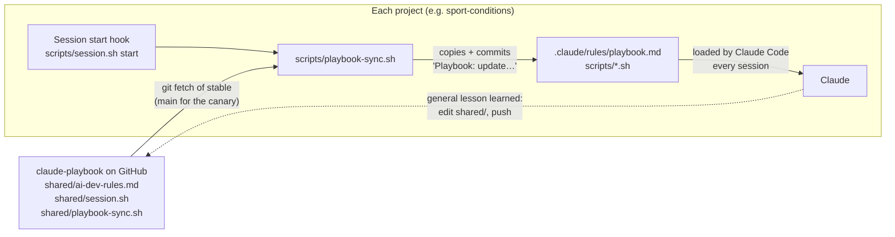

# How the playbook works

The playbook is a set of text documents (written in Markdown, a simple text
format) and a few small programs (shell scripts). It has one moving part: the
**sync**, which copies a change made here into every project the user works on,
on their phone or their Mac. This page explains how the sync works, and where it
can fail.

## The big picture

In words: the playbook on GitHub holds the rules and two scripts. When a
session opens in a project, the project fetches the latest release of the
playbook, copies in anything that changed, and Claude reads the rules. When Claude learns
something useful for every project, it adds it back to the playbook.

## Words used on this page
- **Repo** (repository): a project's folder of files, with its full history,
  kept on GitHub.
- **Commit**: a saved snapshot of the files. **Push**: sending commits to
  GitHub. **`main`**: the one main copy of a repo that every device reads.
- **Clone**: a full copy of a repo on a computer.
- **Hook**: an instruction to Claude Code to run a script automatically at a
  set moment, such as when a session opens. Hooks live in each project's
  `.claude/settings.json`.
- **Cloud session**: a Claude Code session started from the user's phone. It runs
  on Anthropic's computers, not the Mac.
- **Branch**: a separate line of work in a repo. Each session works on its
  own and merges into `main` when a step is finished. **Worktree**: a
  separate copy of a repo's files on the Mac, one per session. How sessions
  stay in step: `reference/phone-and-computer.md`.

## What happens when a session opens in a project
1. **Claude Code runs the start hook** (`SessionStart` in
   `.claude/settings.json`). It runs `scripts/session.sh start`.
   That script fetches the project's latest `main` and lists other sessions' unfinished branches.
2. **The sync finds the playbook.** `session.sh` runs
   `scripts/playbook-sync.sh`. It looks for the playbook in three places, in
   order: the clone on the user's Mac (`~/.claude/skills/new-app`); a clone next
   to the project (a cloud session with the playbook attached); or a fresh
   download of just the latest version into `.session/playbook` (which git
   ignores). Whichever it uses, it always reads a branch of the playbook on
   GitHub, never unsaved edits in a clone: `stable`, or `main` for the
   canary (see "Releases" below).
3. **It copies in what changed.** For each shared file, it compares the
   playbook's version with the project's copy. If they differ, it replaces
   the copy and commits just those files as "Playbook: update shared files
   from claude-playbook". It writes the replacement as a new file, so a
   script that's already running isn't disturbed. The commit goes to GitHub
   with the session's other work.
4. **If the sync script replaced itself, it runs the new version straight
   away.** So a new check (like catch-ups, below) works in that same session,
   not only the next one. I added this on 24 Oct 2026. A project whose script
   is older than that still sees a new check one session late, once.
5. **Claude reads the rules.** Claude Code automatically reads every `.md`
   file in `.claude/rules/` when a session opens, as it does CLAUDE.md. If
   the sync changed the rules, the script tells Claude to read them again.
6. **Catch-ups.** Some rule changes affect files a project already has, not
   just new work (for example, "rewrite the docs in plain English"). These
   are listed in the playbook's `shared/catch-up.md`. The sync prints any
   entry the project hasn't recorded as done in its
   `docs/playbook-catch-up.md`, under "CATCH-UP DUE", one line each (id and
   title); Claude reads the entry from the playbook. The rules tell Claude
   to tell the user, apply it, and record it. Before catch-ups existed, a new rule
   only changed what Claude wrote next, never what was already there.
7. **Set-up check.** The playbook's `shared/setup.txt` lists what every
   project needs besides the copied files: lines in `.gitignore` (the list
   of files git leaves out), the hooks in `.claude/settings.json`, and a few
   files such as `docs/STATUS.md`. The sync checks the project against that
   list. It adds a missing `.gitignore` line or hook itself, and commits it
   as "Playbook: complete the project set-up". It keeps the project's other
   settings. A missing file is only reported, under `SETUP:`, because its
   content belongs to the project. So a new hook added to the playbook
   reaches every project, where before it only reached new ones. I added
   this on 25 Oct 2026.
8. **Other repos in the same cloud session.** Hooks only run in the repo the
   session opened in. So in a cloud session, session start also lists the
   other repos sitting next to it. It says which ones to start by hand, and
   flags any that don't follow the playbook (`NOT SET UP`). At the end of
   every reply, the check also refuses to finish while another attached repo
   has unsaved or unpushed work.
9. **Docs kept true, checked as work lands.** A hook runs `session.sh
   push-check` before every shell command Claude runs; it leaves at once
   unless the command is a push. A `git push` to `main` (in any of its usual
   forms) is refused until docs/STATUS.md is part of what's pushed, and
   SPEC.md too if a file in `specs/` changed (projects without a SPEC.md are
   skipped). Playbook sync commits and GitHub Action bots' commits don't
   count. Claude is mid-turn when it's refused, so it adds the docs and
   pushes again without an extra turn. Until 27 Oct 2026 the end-of-reply
   check did this, which cost a whole extra turn each time; it now only
   checks for lost work. The rule behind it: "Each feature, and keeping the
   docs true" in `shared/ai-dev-rules.md`.

## Releases: how a change reaches the projects
Work lands on the playbook's `main`. Projects don't read `main`: they read
`stable`, a second branch that only moves forward when the user agrees to a
**release**. `scripts/release.sh` makes one: it runs the tests, checks that
`RELEASES.md` has a note for it, asks the user, then moves `stable` to `main`
and tags it `release-YYYY-MM-DD`. When a project updates, session start
prints the note's first line. Projects don't use the tag; it only marks the
release. Cloud sessions can't push tags, so from there the script says how
to add it on the Mac.

One project, the **canary** (Sport Conditions), reads `main` instead, so it
tries every change in real use before the others get it. It says so in a
one-word file, `.claude/playbook-channel` (`main` or `stable`; no file means
`stable`). Projects ignore `.claude/*` in git, so that file is added with
`git add -f`.

If `stable` doesn't exist (before the first release), the sync reads `main`.
A project with a sync script from before releases reads `main`, copies in
the new script, and runs it straight away, which then reads `stable`. To undo
a bad release: revert the commit on `main` and release again. `stable` is
never rewound.

The tests (`tests/run.sh`) build throwaway playbooks and projects in a
temporary folder and run the real scripts against them. A GitHub Action
(`.github/workflows/test.yml`) runs them on every push, on Linux and on
macOS with Apple's bash 3.2.

## The files

| Playbook file | Copy in each project | What it does |
|---|---|---|
| `shared/ai-dev-rules.md` | `.claude/rules/playbook.md` | The shared rules for every project, including using tokens well |
| `shared/session.sh` | `scripts/session.sh` | Session start (pull, other work, issues, handover), the end-of-reply check for lost work, the push-to-main docs check, and the cost notes |
| `shared/playbook-sync.sh` | `scripts/playbook-sync.sh` | The sync itself (copied too, so it can update itself) |
| `shared/catch-up.md` | not copied (the sync reads it) | Rule changes each project must apply once to files it already has. Each project records the ones it has done in `docs/playbook-catch-up.md` |
| `shared/setup.txt` | not copied (the sync reads it) | The set-up every project needs: `.gitignore` lines, hooks, required files. Checked at every session start |
| `templates/*` | copied once, by hand | Starting points for a new project. They don't update afterwards, except the hooks (through `setup.txt`). Any other template change that existing projects need gets a catch-up entry |
| `reference/*` | not copied | Know-how Claude reads only when it needs it |
| `RELEASES.md` | not copied (the sync reads it) | One note per release, newest first. Session start prints the newest note's first line when a project updates |
| `scripts/release.sh` | not copied | Makes a release: tests, note, the user's yes, then `stable` moved to `main` and tagged |
| `tests/run.sh` | not copied | The kept tests, run by the GitHub Action on Linux and macOS |
| (none) | `.claude/playbook-channel` | Only in the canary: reads `main`, so it syncs from `main` |
| `owner/profile.md` | `.claude/rules/owner.md` | The owner's accounts, devices and preferences, kept apart so others can copy the playbook (a fork replaces `owner/` and `PLAYBOOK_URL` in `shared/playbook-sync.sh`) |
| `templates/.claude/agents/*.md` | `.claude/agents/*.md` | The `scout` (cheap model: searching, boiling down data) and `checker` (mid model: checking a step against its spec) subagents |

Changes also flow the other way. The rules tell Claude to file a lesson
useful for every project as an `idea` issue on this repo, in general terms
(it's public), instead of editing the playbook from a project session. A
playbook session then works through the ideas in a batch. That's an
instruction Claude follows, not something automatic.

## Cost notes
The rules' "Using tokens well" section says how Claude keeps sessions
efficient. One signal comes from a script. A hook runs `session.sh busy`
every time the user sends a message. It reads the session's transcript (the
log Claude Code keeps, whose path the hook passes in) and compares the size
of the latest request's context with the first one's, which is about what a
fresh session costs. Subagents' requests are left out.
- Past 3× it prints one `COST:` line (each message now re-reads about N
  tokens, about R× a fresh session's), and past 6× one more. Each is said
  once per session (remembered in `.session/cost-<session id>`, not saved
  to GitHub).
- If the last reply was more than 55 minutes ago and the context is over 2×
  a fresh one's, it says the cache has likely expired, so this message pays
  full price: a natural moment to start fresh.
- The numbers sit at the top of `session.sh` and match the assumptions table
  in `reference/efficient-sessions.md`. Without `python3` it says nothing.

This replaced a message counter (a `COACH:` line every 15 messages) on 27 Oct
2026: a count says nothing about cost, and a long but small session is fine.

## Public or private
When a session opens, `session.sh` asks GitHub whether the repo is public.
It compares the answer with `.claude/repo-visibility`, a saved file holding
the last answer that was reviewed. If a repo has become public, it prints
`THIS REPO IS NOW PUBLIC`. The rules ("Safety and responsibility") then make Claude tell
the user, and check the files and their history for private details, before doing
anything else. The warning repeats at every session start until
`scripts/session.sh visibility-ok` records that the review is done. If
GitHub can't be reached, it says nothing, so it's a safety net, not a
guarantee.

## Why this design, and not the alternatives
I checked these against Claude Code's documentation on 23 Oct 2026. More
detail in `docs/decisions.md`.
- **Plugins** (Claude Code's official add-on packages) are the standard way to
  share skills and hooks. But cloud sessions don't load them, and they can't
  carry rules the way CLAUDE.md does.
- **Imports** (a line in CLAUDE.md starting `@` that pulls in another file)
  can point outside the repo, such as `@~/.claude/...`. But that folder only
  exists on the Mac, and an import can't be a web address.
- **A copy saved in each project** works everywhere, even offline. Git's
  history also shows exactly which rules each session had.
- **No lock between sessions** (removed 27 Oct 2026). Claude Code has no
  built-in lock across devices; worktrees, own branches and GitHub refusing
  out-of-date pushes keep sessions' work apart. See `docs/decisions.md`.

## Limits and weak spots
- **The playbook repo is public** (since 23 Oct 2026), so any session can
  sync from it without logging in. The flip side: anything saved here is
  public. The rules tell Claude to check each change for private details and
  ask the user first. That's an instruction, not an automatic scan.
- **Hooks don't always run.** In a cloud session that started before a
  project had hooks, nothing syncs until someone runs `scripts/session.sh
  start` by hand.
- **A session with several repos attached runs hooks only in the one it
  opened in.** Session start lists the other attached repos, and the
  end-of-reply check catches their unsaved or unpushed work. But running
  session start in them (so they sync) is still Claude following a rule. A
  repo attached in the middle of a session isn't listed at start, though
  the end-of-reply check still covers it.
- **The set-up check only adds.** Removing or renaming a hook, or a
  `.gitignore` line, needs a catch-up entry. A hook it adds starts working
  from the next session. It needs `python3` to check the hooks (there on
  the user's Mac with Apple's developer tools, and in cloud sessions); without
  it, it says so.
- **If GitHub can't be reached,** the sync prints `PLAYBOOK NOT SYNCED` with
  the date of the copy in use, and the rules tell Claude to tell the user.
- **A project nobody opens doesn't update.** Each project catches up at its
  next session, not before. That's fine, because the rules only matter while
  Claude works there.
- **A repo that was never set up gets nothing.** The sync only reaches repos
  that have `scripts/playbook-sync.sh`. The rules say every repo of the user's is
  set up, and tell Claude to offer when it finds one that isn't.
- **Hooks run the main checkout's copy of `session.sh`**, even for a session
  in a worktree (`$CLAUDE_PROJECT_DIR` is the folder the session started in).
  The script reads the hook's `cwd` field, and if that's a worktree of the
  same repo it checks there, with that worktree's own copy. Session start
  also fast-forwards the main checkout (only if it's on main with nothing
  unsaved), so the copy hooks start from stays current. Until it has the
  new script once, a stale main checkout runs the old checks.
- **Session start can't see a cloud session's work it hasn't pushed**, nor a
  Mac session's uncommitted changes. It shows only branches with commits.
  Two sessions can still edit the same file; git then flags a conflict when
  the second one merges, and Claude stops and tells the user.
- **A broken `shared/session.sh` would spread to every project at the next
  release.** The tests and the canary are there to catch it first. They only
  catch what they test, and the canary only what its sessions use.
- **If fetching `stable` fails but `main` worked,** the sync uses the last
  `stable` it fetched (an older release, which is safe).
- **Claude Code may read `.claude/rules/` before the hook runs**, so a session
  can start on the previous rules. The sync's message asks Claude to read
  them again.
- **Each sync adds a small commit** to the project's history.
- **Catch-ups rely on Claude doing them.** The sync only prints a reminder.
  It prints it at every session start until the project records it as done,
  so it can't be missed, but it can be put off.
