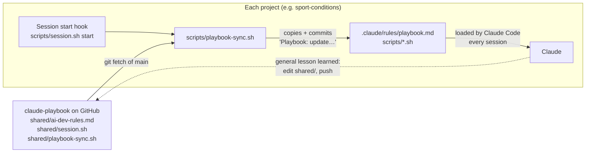

# How the playbook works

The playbook is a set of text documents (written in Markdown, a simple text
format) and a few small programs (shell scripts). It has one moving part: the
**sync**, which copies a change made here into every project Leo works on,
on his phone or his Mac. This page explains how the sync works, and where it
can fail.

## The big picture

In words: the playbook on GitHub holds the rules and two scripts. When a
session opens in a project, the project fetches the latest playbook, copies
in anything that changed, and Claude reads the rules. When Claude learns
something useful for every project, it adds it back to the playbook.

## Words used on this page
- **Repo** (repository): a project's folder of files, with its full history,
  kept on GitHub.
- **Commit**: a saved snapshot of the files. **Push**: sending commits to
  GitHub. **`main`**: the one main copy of a repo that every device reads.
- **Clone**: a full copy of a repo on a computer.
- **Hook**: an instruction to Claude Code to run a script automatically at a
  set moment, such as when a session opens. Hooks live in each project's
  `.claude/settings.json`.
- **Cloud session**: a Claude Code session started from Leo's phone. It runs
  on Anthropic's computers, not the Mac.
- **Session lock**: a small marker on GitHub that says "Claude is replying on
  this device right now", so the phone and Mac don't both change a project at
  once. How it works: `reference/phone-and-computer.md`.

## What happens when a session opens in a project
1. **Claude Code runs the start hook** (`SessionStart` in
   `.claude/settings.json`). It runs `scripts/session.sh start`.
   That script fetches the project's latest `main` and checks the session lock.
2. **The sync finds the playbook.** `session.sh` runs
   `scripts/playbook-sync.sh`. It looks for the playbook in three places, in
   order: the clone on Leo's Mac (`~/.claude/skills/new-app`); a clone next
   to the project (a cloud session with the playbook attached); or a fresh
   download of just the latest version into `.session/playbook` (which git
   ignores). Whichever it uses, it always reads the playbook's `main` on
   GitHub, never unsaved edits in a clone.
3. **It copies in what changed.** For each shared file, it compares the
   playbook's version with the project's copy. If they differ, it replaces
   the copy and commits just those files as "Playbook: update shared files
   from claude-playbook". It writes the replacement as a new file, so a
   script that's already running isn't disturbed. The commit goes to GitHub
   with the session's other work.
4. **If the sync script replaced itself, it runs the new version straight
   away.** So a new check (like catch-ups, below) works in that same session,
   not only the next one. I added this on 24 Oct 2026. A project whose script
   is older than that still sees a new check one session late, once.
5. **Claude reads the rules.** Claude Code automatically reads every `.md`
   file in `.claude/rules/` when a session opens, as it does CLAUDE.md. If
   the sync changed the rules, the script tells Claude to read them again.
6. **Catch-ups.** Some rule changes affect files a project already has, not
   just new work (for example, "rewrite the docs in plain English"). These
   are listed in the playbook's `shared/catch-up.md`. The sync prints any
   entry the project hasn't recorded as done in its
   `docs/playbook-catch-up.md`, under "CATCH-UP DUE". The rules tell Claude
   to tell Leo, apply it, and record it. Before catch-ups existed, a new rule
   only changed what Claude wrote next, never what was already there.

## The files

| Playbook file | Copy in each project | What it does |
|---|---|---|
| `shared/ai-dev-rules.md` | `.claude/rules/playbook.md` | Leo's rules for every project, including coaching |
| `shared/session.sh` | `scripts/session.sh` | The session lock, the end-of-reply checks, and the message counter for coaching |
| `shared/playbook-sync.sh` | `scripts/playbook-sync.sh` | The sync itself (copied too, so it can update itself) |
| `shared/catch-up.md` | not copied (the sync reads it) | Rule changes each project must apply once to files it already has. Each project records the ones it has done in `docs/playbook-catch-up.md` |
| `templates/*` | copied once, by hand | Starting points for a new project. They don't update afterwards |
| `reference/*` | not copied | Know-how Claude reads only when it needs it |

Changes also flow the other way. The rules tell Claude that a lesson useful
for every project goes into this repo, not just the project. That's an
instruction Claude follows, not something automatic.

## Coaching
Coaching means Claude nudging Leo to use sessions well, for example
suggesting a fresh session when one gets long. Here's how it's triggered.

A hook runs `session.sh busy` every time Leo sends a message. It counts the
messages in each session, in a file that isn't saved to GitHub
(`.session/messages-<session id>`). Every 15 messages it prints a line
starting `COACH:`, with the size of the conversation so far. Claude Code
passes that line to Claude. The rules' "Coaching" section says what Claude
does with it, and with other signs, such as several topics in one message.
The number 15 is our own judgement, not a figure from Anthropic.

## Public or private
When a session opens, `session.sh` asks GitHub whether the repo is public.
It compares the answer with `.claude/repo-visibility`, a saved file holding
the last answer that was reviewed. If a repo has become public, it prints
`THIS REPO IS NOW PUBLIC`. The rules ("Public repos") then make Claude tell
Leo, and check the files and their history for private details, before doing
anything else. The warning repeats at every session start until
`scripts/session.sh visibility-ok` records that the review is done. If
GitHub can't be reached, it says nothing, so it's a safety net, not a
guarantee.

## Why this design, and not the alternatives
I checked these against Claude Code's documentation on 23 Oct 2026. More
detail in `docs/decisions.md`.
- **Plugins** (Claude Code's official add-on packages) are the standard way to
  share skills and hooks. But cloud sessions don't load them, and they can't
  carry rules the way CLAUDE.md does.
- **Imports** (a line in CLAUDE.md starting `@` that pulls in another file)
  can point outside the repo, such as `@~/.claude/...`. But that folder only
  exists on the Mac, and an import can't be a web address.
- **A copy saved in each project** works everywhere, even offline. Git's
  history also shows exactly which rules each session had.

## Limits and weak spots
- **The playbook repo is public** (since 23 Oct 2026), so any session can
  sync from it without logging in. The flip side: anything saved here is
  public. The rules tell Claude to check each change for private details and
  ask Leo first. That's an instruction, not an automatic scan.
- **Hooks don't always run.** In a cloud session that started before a
  project had hooks, nothing syncs until someone runs `scripts/session.sh
  start` by hand.
- **A session with several repos attached may run hooks in none of them**,
  or only in the one it opened in. The rules tell Claude to run session start
  in each repo it changes. That's an instruction, not automatic.
- **A repo that was never set up gets nothing.** The sync only reaches repos
  that have `scripts/playbook-sync.sh`. The rules say every repo of Leo's is
  set up, and tell Claude to offer when it finds one that isn't.
- **A broken `shared/session.sh` would spread to every project.** So test any
  change in a throwaway repo before pushing (see CLAUDE.md).
- **Claude Code may read `.claude/rules/` before the hook runs**, so a session
  can start on the previous rules. The sync's message asks Claude to read
  them again.
- **Each sync adds a small commit** to the project's history.
- **Catch-ups rely on Claude doing them.** The sync only prints a reminder.
  It prints it at every session start until the project records it as done,
  so it can't be missed, but it can be put off.
