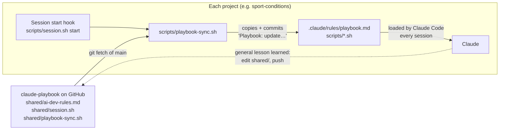

# How the playbook works

The playbook is a set of Markdown documents and two small shell scripts. Its
one moving part is the **sync**: a change made once here reaches every
project Leo works on, on phone or Mac. This page explains that, and its limits.

## The big picture

## What happens at a project's session start
1. Claude Code runs the project's `SessionStart` hook (`.claude/settings.json`):
   `scripts/session.sh start`. It pulls the project's latest `main` and checks
   the lock (see `reference/phone-and-computer.md`).
2. `session.sh` runs `scripts/playbook-sync.sh`, which finds the playbook:
   a clone on the Mac (`~/.claude/skills/new-app`), a clone next to the
   project (a cloud session with the playbook attached), or a fresh
   one-commit download into `.session/playbook` (ignored by git). It always
   reads the playbook's **GitHub `main`**, never a clone's unsaved edits.
3. For each shared file it compares the playbook's version with the
   project's copy. If they differ it replaces the copy (as a new file, so a
   script that's running isn't disturbed) and commits just those files as
   "Playbook: update shared files from claude-playbook". The commit is pushed
   with the session's other work.
4. Claude Code loads `.claude/rules/playbook.md` (every `.md` in
   `.claude/rules/` is loaded at launch, like CLAUDE.md). If the sync changed
   it, the script tells Claude to read it again.

## The files

| Playbook file | Project copy | Its job |
|---|---|---|
| `shared/ai-dev-rules.md` | `.claude/rules/playbook.md` | Leo's rules for every project, including coaching |
| `shared/session.sh` | `scripts/session.sh` | Session lock, handover checks, the message counter for coaching |
| `shared/playbook-sync.sh` | `scripts/playbook-sync.sh` | The sync itself (so it can update too) |
| `templates/*` | copied once by hand | Starting points; they don't update |
| `reference/*` | not copied | Read on demand by Claude when needed |

The other way round: the shared rules tell Claude that a lesson which applies
to AI development generally goes into this repo, not just the project. That's
an instruction Claude follows, not an automatic mechanism.

## Coaching
`session.sh busy` runs on every message Leo sends. It counts messages per
session (`.session/messages-<session id>`, not committed) and every 15 prints
a `COACH:` line that Claude Code adds to Claude's context, with the session's
transcript size. The rules' "Coaching" section says what Claude does with it
(and with other signals, like mixed topics). 15 is a judgement call, not from
Anthropic's docs.

## Public or private
At each session start `session.sh` asks GitHub's public API whether the repo
is public, and compares with `.claude/repo-visibility` (the last reviewed
answer, committed). If a repo has turned public, it prints `THIS REPO IS NOW
PUBLIC`; the rules ("Public repos") then have Claude tell Leo and review the
files and history before anything else. The warning repeats every session
until `scripts/session.sh visibility-ok` records the review. If GitHub can't
be reached it says nothing, so it's a safety net, not a guarantee.

## Why this design (and not the alternatives)
Checked against Claude Code's documentation on 23 Oct 2026; see
`docs/decisions.md`.
- **Plugins** are Claude Code's official way to share skills and hooks, but
  cloud sessions don't load them, and plugins can't carry CLAUDE.md-style rules.
- **`@` imports** in CLAUDE.md can point outside the repo
  (`@~/.claude/...`), but that path only exists on the Mac, and imports can't
  be web addresses.
- **A copy committed in each project** works everywhere, offline, and shows
  in git history exactly which rules a session had.

## Limits and weak spots
- **The playbook repo is public** (since 23 Oct 2026), so any session can
  sync from it without logging in. The flip side: anything committed here is
  public. The shared rules tell Claude to check each change for private
  details and ask Leo first; that's an instruction, not an automatic scan.
- **Hooks don't always fire** in a cloud session started before they existed;
  then nothing syncs until `scripts/session.sh start` is run by hand.
- **A broken `shared/session.sh` would spread to every project.** Test
  changes in a throwaway repo before pushing (see CLAUDE.md).
- **Claude Code may load `.claude/rules/` before the hook runs**, so a session
  can start on the previous rules. The sync's message asks Claude to re-read them.
- Playbook syncs add small commits to each project's history.
