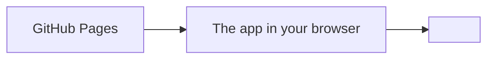

# How <App name> works

The map of the app: what the parts are, how data flows between them, what we
rely on from outside, and where the weak spots are. Read this first to
understand the code. Claude updates it whenever the structure changes.

## The big picture

<One paragraph: what runs where, and why (e.g. "no server of our own").
Explain each technical term the first time it appears.>

## What happens when you open the page
1. <Step by step, from loading the files to drawing the screen.>

## The core logic
<The rules that decide things (e.g. ratings): where they are and how they work.>

## The files
| File | Its job |
|---|---|
| `index.html` | |

## What's stored where
| What | Where | Who can see it |
|---|---|---|

## Outside services, limits and terms
| Service | Used for | Limits and terms |
|---|---|---|

## Safety and security
- Secrets: <where they live>
- People's input: <how it's escaped / checked>
- <Anything that could mislead or harm, and what we do about it>

## How changes are checked
- <Tests, preview script, live checks. And what isn't checked yet.>

## Weak spots (known, not yet fixed)
- <Honest list: missing tests, approximate data, code that needs splitting.>
